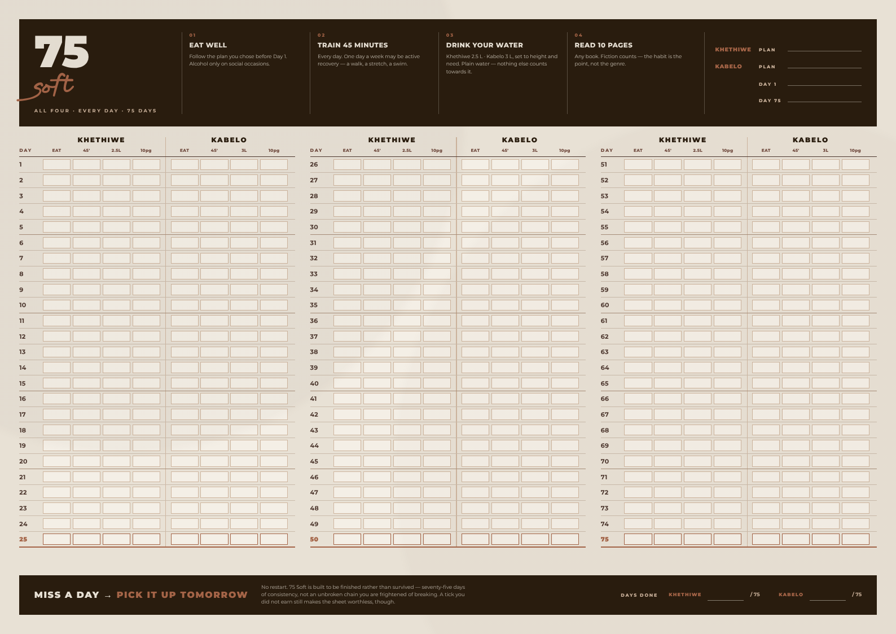

# 75 SOFT — two-person tracker

One **A3 landscape** sheet (420 × 297 mm). 75 days, two people, 600 tick boxes.



---

## What's here

| File | What it is |
|---|---|
| `print/75-soft-A3-landscape.pdf` | The sheet, print-ready — 1 page, A3 landscape |
| `tracker.html` | The same sheet on screen |
| `print.html` | The print stylesheet version, if you'd rather print from a browser |
| `preview/tracker-A3.png` | The image above |
| `build.py` | Regenerates both HTML files |
| `render.mjs` | Re-renders the preview and the PDF, and checks the sheet doesn't overflow |
| `fonts/` | Mairo and Montserrat, embedded into the output as base64 |

## Printing

Print at **100% / "Actual size"**, A3, **landscape**, background graphics **on**.
Fit-to-page shrinks the boxes below the size of a pen tick.

160 gsm matte survives 75 days on a wall and takes ballpoint without bleeding
through. If you only have A4, printing at 71% still works but the boxes get
tight. A3 is worth the trip to a print shop.

---

## The four rules

| | Rule | |
|---|---|---|
| 01 | **Eat well** | Follow the plan you chose before Day 1. Alcohol only on social occasions. |
| 02 | **Train 45 minutes** | Every day. One day a week may be active recovery — a walk, a stretch, a swim. |
| 03 | **Drink your water** | Khethiwe 2.5 L · Kabelo 3 L, set to height and need. |
| 04 | **Read 10 pages** | Any book. Fiction counts — the habit is the point, not the genre. |

And the rule that defines the thing: **miss a day, pick it up tomorrow.** No
restart. 75 Soft is built to be finished rather than survived.

### What changed from 75 Hard

One 45-minute workout instead of two · no outdoor requirement · three litres
instead of a gallon · any book instead of non-fiction only · alcohol allowed
socially · and no going back to Day 1.

**The progress picture is gone**, because it is not a 75 Soft rule. Add
`("PIC", "progress")` back to `TASKS` in `build.py` if you want the column.

**The water targets are still yours, not the standard three litres** — 2.5 L and
3 L, set to height and need.

---

## How it's laid out

Three blocks of 25 days, left to right: **1–25**, **26–50**, **51–75**.

Both people sit on the **same day row**, separated by a vertical rule —
**Khethiwe** on the left, **Kabelo** on the right. That's the point of the thing:
a glance down the sheet shows who is behind, and on what, without comparing two
separate charts.

The names and water targets are set in `build.py` → `PEOPLE`; change them there
and rebuild. The water column header is per person, so each of you ticks against
your own number.

Every fifth day carries a heavier rule so you can count down the sheet at a
glance. **Days 25, 50 and 75** are marked in terracotta.

The header carries both names, a blank for each **chosen plan** (rule 1 says pick
it before Day 1 — writing it on the sheet is what stops it being renegotiated in
week three), and the Day 1 / Day 75 dates.

The footer carries a **days done** line each, out of 75 — a count rather than a
streak, which is the whole difference between Soft and Hard.

---

## A note on the design

Ticking is deliberately cheap and visible: a wall of filled boxes is the
motivational mechanism, and with four rules instead of six the boxes are wider
and easier to hit with a pen.

Palette and type match the vision board in `../vision-board`, so the two hang
together on the same wall.

---

## Editing

```bash
python3 build.py                        # rewrites tracker.html and print.html
npm i playwright && node render.mjs     # refreshes preview/ and print/
```

The sheet is fixed at exactly A3 and clips anything that doesn't fit, so
`render.mjs` checks for overflow and prints the box count. If you change the row
height, the block count or the task list at the top of `build.py`, run it and
check it still says *fits*.
