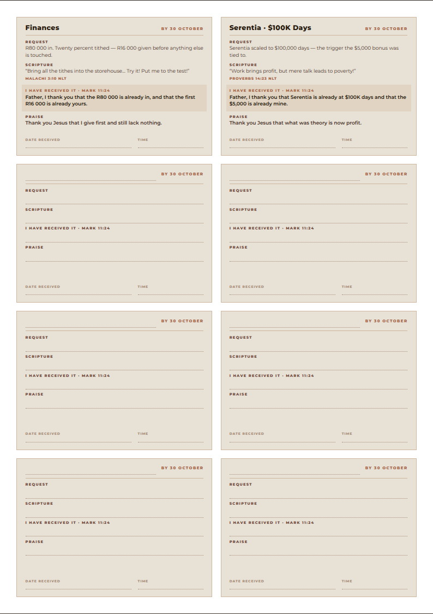

# Prayer cards

Cut-out cards, **8 to an A4 sheet**. One page: 2 written, 6 ruled blanks.



---

## What's here

| File | What it is |
|---|---|
| `print/prayer-cards-A4.pdf` | Both pages, print-ready — A4 portrait |
| `cards.html` | The same pages on screen |
| `print.html` | The print stylesheet version |
| `preview/cards-p1.png` | The page |
| `build.py` | The cards themselves live here — edit and rebuild |
| `render.mjs` | Re-renders the previews and the PDF, and checks no card overflows its cut line |

## Printing and cutting

A4 portrait, **100% / "Actual size"**, backgrounds **on**.

**200–250 gsm card stock** if you want these to survive being carried around;
ordinary paper works if they're going on a mirror or in a Bible.

Cards are **95 × 67.25 mm** with a hairline border to cut along, and there are
4 mm gutters between them, so this prints on any printer — no borderless, no
bleed. Cut down the gutters with a guillotine or straight down the border lines
with scissors.

---

## What's on a card

Four parts, in this order, because the order is the point:

| Block | What goes in it |
|---|---|
| **Request** | The specific thing, in one line. Not "bless my work" — a number and a date. |
| **Scripture** | The verse that holds the faith up while you wait. NLT throughout. |
| **I have received it** | The prayer, in the **past tense**, with a date and time to write in. |
| **Praise** | Thanks given for it as though it is already done. |

The third block carries **Mark 11:24** on every card — *"you can pray for
anything, and if you believe that you've received it, it will be yours."* That's
why it is written as a thing already had rather than a thing still wanted, and
why there is somewhere to write the date and time you prayed it. Every card is
dated **by 30 October**.

### The two written cards

**Finances** — R80 000 in, twenty percent tithed (R16 000) before anything else
is touched. Malachi 3:10.

**Serentia · $100K days** — the trigger the $5,000 bonus was tied to, from the
12 October call with Calvin. Proverbs 14:23.

Then six ruled blanks to fill in by hand as things come up.

---

## Editing

The cards are a list of dicts at the top of `build.py`. Add, remove or
reword, then:

```bash
python3 build.py                        # rewrites cards.html and print.html
npm i playwright && node render.mjs     # refreshes preview/ and print/
```

`BLANKS` sets how many ruled cards are added at the end; the build pads to whole
pages of eight.

**Keep the lines short.** A card is 95 mm wide and fixed height — `render.mjs`
fails loudly and names any card whose text overruns its cut line, so run it after
every edit rather than trusting the HTML to look fine.
