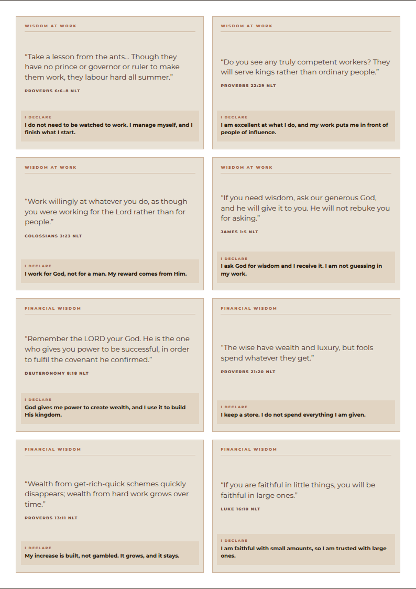

# Scripture cards

Scripture and declaration, **8 to an A4 sheet**. Six topics, four scriptures
each — 24 cards over three pages, plus a page of six title cards for the wall.



---

## What's here

| File | What it is |
|---|---|
| `print/scripture-cards-A4.pdf` | The 24 cards — 3 pages, A4 portrait |
| `print/topic-titles-A4.pdf` | The 6 title cards — 1 page, A4 portrait |
| `cards.html` / `titles.html` | The same pages on screen |
| `print-cards.html` / `print-titles.html` | The print stylesheet versions |
| `preview/` | Every page as an image |
| `build.py` | The topics, verses and declarations live here |
| `render.mjs` | Re-renders previews and both PDFs, and checks no card overflows its cut line |

## Printing and cutting

A4 portrait, **100% / "Actual size"**, backgrounds **on**.

**200–250 gsm matte** — the title cards are solid espresso and will cockle thin
paper. Both sheets have 4 mm gutters, so they print on any printer: no
borderless, no bleed. Cut down the gutters or along the borders.

Scripture cards are **95 × 67.25 mm**; title cards are **95 × 91 mm**, bigger so
they read as headers from across the room.

---

## The six topics

| # | Title | Scriptures |
|---|---|---|
| 01 | **Wisdom at Work** | Proverbs 6:6–8 · Proverbs 22:29 · Colossians 3:23 · James 1:5 |
| 02 | **Financial Wisdom** | Deuteronomy 8:18 · Proverbs 21:20 · Proverbs 13:11 · Luke 16:10 |
| 03 | **Discipline** | 1 Corinthians 9:27 · Hebrews 12:11 · Proverbs 25:28 · 2 Timothy 1:7 |
| 04 | **Leader and Disciple** | Mark 10:43–44 · Luke 6:40 · 1 Timothy 4:12 · John 8:31 |
| 05 | **My Father, My Source** | Psalm 23:1 · Matthew 7:11 · James 1:17 · Romans 8:15 |
| 06 | **Protection** | Psalm 91:1–2 · Psalm 121:7–8 · Isaiah 54:17 · Proverbs 18:10 |

Four per topic, so the deck lands on exactly three full pages of eight.

### On a card

The **topic title** sits at the top of every card, so one that comes off the wall
still knows where it belongs. Then the **verse** — the largest thing on the card,
centred, because that is what you are meant to read from a distance. Then the
reference, then the **declaration**: the verse spoken back in the first person
and the present tense.

The pairing is the point. *"Take a lesson from the ants… though they have no
prince or governor or ruler to make them work"* becomes **"I do not need to be
watched to work. I manage myself, and I finish what I start."** That verse is on
the Wisdom at Work card precisely because you asked for a hard worker who runs
like a manager — the ant with no overseer is the closest scripture gets to it.

All NLT.

---

## Putting them up

The title cards are the headers. Pin one, hang its four scripture cards beneath,
repeat. Six columns of five, or three blocks of two — whatever the wall takes.

---

## Editing

Topics, verses and declarations are a list of dicts at the top of `build.py`:

```bash
python3 build.py                        # rewrites all four HTML files
npm i playwright && node render.mjs     # refreshes preview/ and print/
```

Add or remove verses freely — the build pads into pages of eight on its own, and
the title card shows each topic's live scripture count. **Keep verses short.**
A card is 95 mm wide and fixed height; `render.mjs` fails loudly and names any
card whose text overruns its cut line, so run it after every edit.
